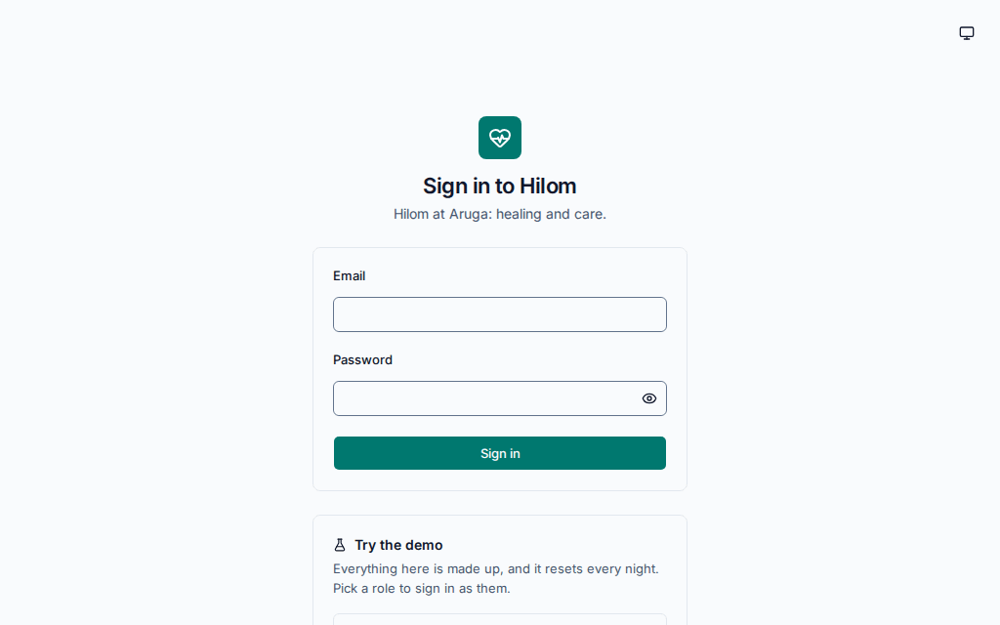
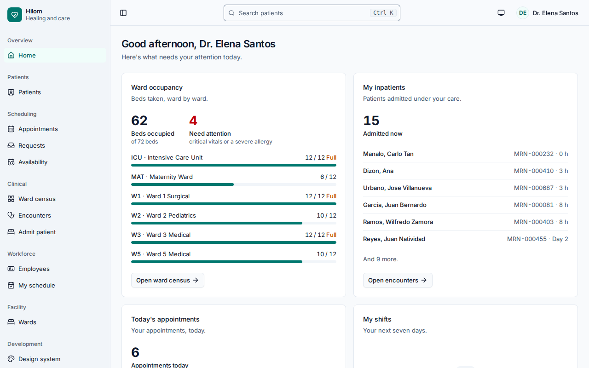
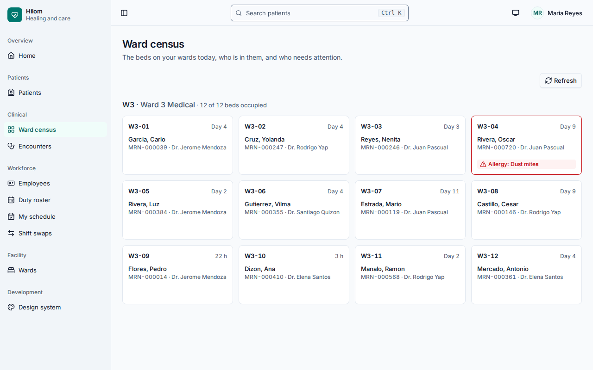
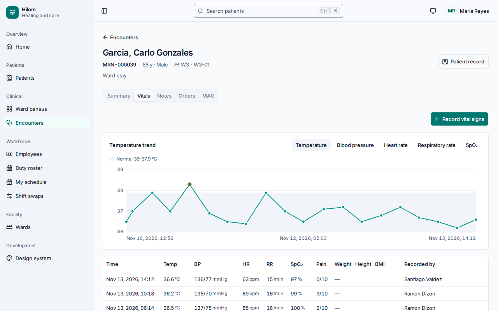
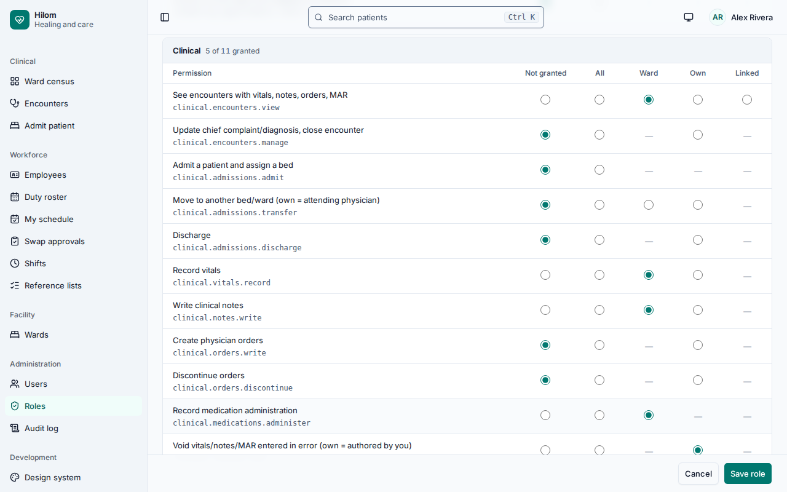
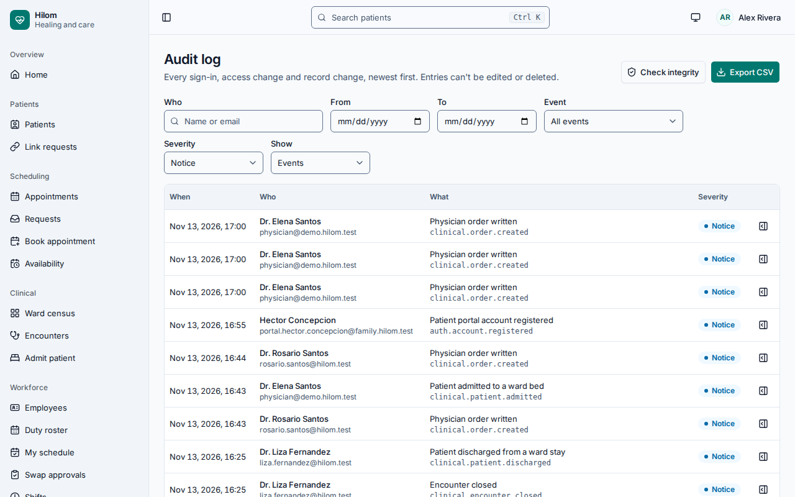
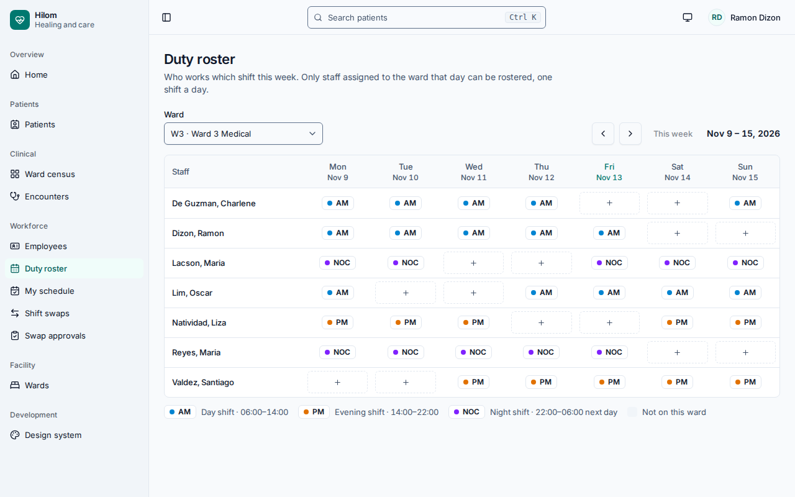
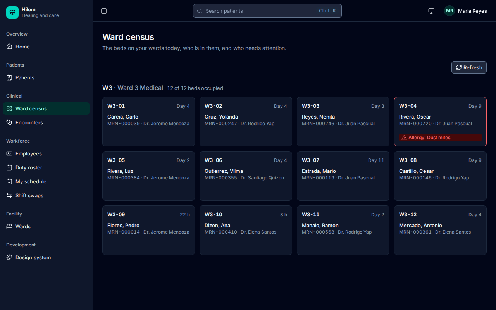
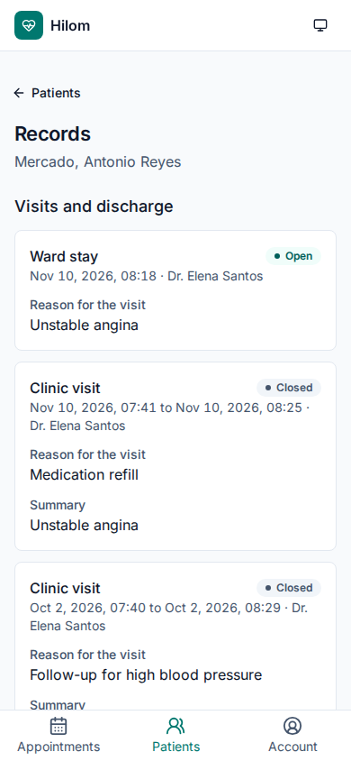
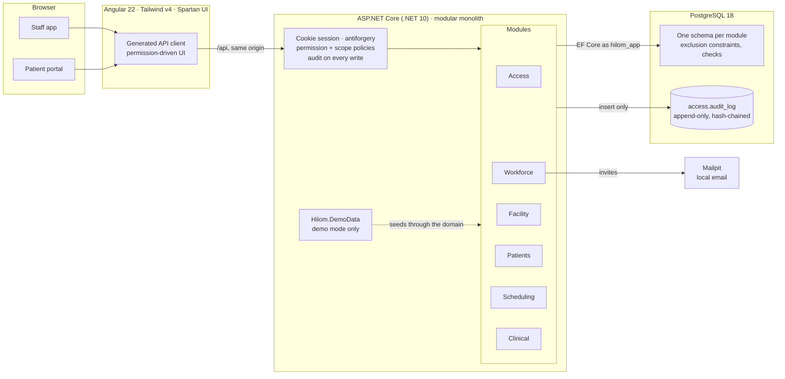

# Hilom

[](https://github.com/bienthehuman/hilom/actions/workflows/ci.yml)

*Hilom at Aruga: healing and care, in one hospital system.*

Hilom is a hospital information system for outpatient appointments, inpatient ward care and hospital staff. It merges three earlier Laravel apps I built (one for appointments, one for ward care, one for nurse rostering) into one system, rebuilt from scratch on ASP.NET Core, Angular and PostgreSQL. [How three apps became one](docs/CONSOLIDATION.md) tells that story.



> **Status:** Phases 0–3 are released (`v0.1.0` to `v0.3.0`). Phase 4 (dashboards, audit completion, demo data, quality pass, these docs) is done apart from hosting, which is still undecided, so Hilom runs locally for now. See the [build plan](docs/BUILD_PLAN.md).

## What it does

- **Scheduling:** doctors publish availability. Patients, their representatives or the front desk book appointments.
- **Clinical:** check-in, admission to a ward bed, transfers, vital signs, clinical notes, physician orders, medication administration, discharge.
- **Workforce:** staff records and onboarding, ward assignments, duty roster, shift swaps.
- **Patient portal:** optional accounts. One account can manage several patients (for example, a daughter for her parents), and staff verify every link.
- **Access control:** admins build roles from permissions in the UI, and each permission is scoped to *all*, *my ward*, *my own* or *linked* records. No role is hardcoded.
- **Audit:** critical actions, data changes, patient-record views, failed logins and denied access are logged in an append-only, tamper-evident log.

## Screenshots

All taken from the seeded demo hospital, where every name is made up.

| | |
|---|---|
|  |  |
| **Role dashboards.** Each home page is built from the user's permissions. | **Ward census.** A nurse sees the beds on her assigned wards, and nothing else. |
|  |  |
| **Patient chart.** Vitals, notes, orders and the medication record hang off one encounter. | **Role editor.** Each grant picks a scope: all, ward, own or linked. |
|  |  |
| **Audit log.** Append-only, hash-chained, with an integrity check. | **Duty roster.** The database rejects a second shift on the same day. |
|  |  |
| **Dark mode** throughout. | **Patient portal** on a phone, as the daughter following her father's care. |

## Run it locally with the demo hospital

**Prerequisites:** .NET 10 SDK, Node.js 24 with Corepack (for pnpm), Docker.

1. Start PostgreSQL and the Mailpit inbox:

   ```bash
   cp .env.example .env      # change HILOM_DB_PORT here if 5432 is taken
   ```

   ```bash
   docker compose up -d
   ```

2. Start the API in demo mode. On an empty database it generates a fictional hospital: wards, staff, about 800 patients and two months of appointments, stays, vitals, medication rounds and audit history. That takes a minute or two at `Small`. Using a database of its own (`hilom_demo`) keeps it apart from your development data:

   ```bash
   cd api && dotnet build src/Hilom.Api
   ```

   ```bash
   cd api && HILOM_DB_NAME=hilom_demo Demo__Enabled=true Demo__Scale=Small dotnet run --no-build --project src/Hilom.Api
   ```

   Build first, then run with `--no-build`: the demo settings would otherwise reach the build's OpenAPI step. The API is ready when http://localhost:5080/health/ready answers `Healthy`.

3. Start the web app:

   ```bash
   cd web && pnpm install && pnpm start
   ```

4. Open http://localhost:4200 and pick a role under **Try the demo**. Every demo login uses the password `Hilom-Demo-2026`, and the sign-in page fills it for you. The portal's sign-in page is at http://localhost:4200/portal/login.

The demo resets itself at 03:00 hospital time (Asia/Manila), so whatever you change is gone the next day. It refuses to run on a database that already holds patients or staff. Settings and the reasoning are in [ADR 0009](docs/adr/0009-demo-data-through-the-domain.md).

Staff invites and other email land in Mailpit at http://localhost:8025.

### Without the demo

Leave out `HILOM_DB_NAME` and the `Demo__` settings and the API starts on the `hilom` database with only the development administrator, `admin@hilom.test` / `Hilom-Dev-Admin-2026` (local development only). The API reference is at http://localhost:5080/scalar.

### Tests

```bash
cd api && dotnet test     # unit, architecture and integration tests (integration tests need Docker)
```

```bash
cd web && pnpm test:ci && pnpm e2e     # unit tests, then Playwright + axe in light and dark mode
```

`pnpm e2e` starts its own API and dev server on their own ports against a fresh `hilom_e2e` database. `pnpm showcase` retakes the screenshots and the GIF above from a freshly seeded demo.

## Try it: one tour per role

Each demo login is one person in the same hospital. The links below assume the web app on port 4200.

| Role | Who | Try this |
|---|---|---|
| **Physician** | Dr. Elena Santos | The home page lists your inpatients and today's clinic. Open **Encounters**, pick a patient, and write a note or an order. Discharge someone from a ward stay. Under **Availability**, publish next week's slots. **Patients** lists only the people you've seen or are booked to see: your grant is scoped to `own`. |
| **Staff Nurse** | Maria Reyes, Ward 3 | **Ward census** shows only Ward 3. Open a patient, record vital signs (an out-of-range value is flagged), and give a dose on the **MAR** tab. A dose for a patient with a matching allergy asks you to confirm. Under **Shift swaps**, a colleague's request is waiting for your answer. |
| **Head Nurse** | Ramon Dizon, Ward 3 | **Duty roster** for Ward 3: fill an empty cell. Only nurses assigned to the ward can be rostered, one shift a day. **Swap approvals** has a swap both nurses agreed to, waiting for you. Transfer a patient to another ward and see who can still open their chart. |
| **Chief Nurse** | Teresita Villanueva | The census covers every ward. Open a nurse under **Employees** and assign her to another ward: her census changes on the next request, with no setting to touch. |
| **Front Desk** | Joy Bautista | **Link requests** holds portal users asking to be linked to a patient: match one to a record and approve it, or reject it. **Appointments** lists today's clinic; check a patient in to open their visit. **Book appointment** books a free slot for a walk-in. |
| **HR Officer** | Lourdes Navarro | **Employees**: hire someone and send an invite. The email lands in Mailpit (http://localhost:8025), and its link sets up the account. |
| **System Administrator** | Alex Rivera | **Roles**: open Staff Nurse and change a scope, or build a new role from scratch. **Audit log**: filter by person, event or severity, open an entry to see its field changes, export CSV, and press **Check integrity** to verify the hash chain. |
| **Patient Portal User** | Liza Mercado | Sign in at `/portal/login`, ideally on a phone-sized window. Liza follows her father's care: his ward stay and past visits under **Patients**, and **Appointments** to book him a clinic slot. |

Every action above goes through a permission plus a scope, and the critical ones show up in the administrator's audit log. Try one as the nurse, then find it as Alex.

## Architecture



- **One backend, six modules.** Each module owns its tables in its own Postgres schema, and architecture tests keep the dependency direction (Clinical at the top; Access and Facility at the bottom). See [Architecture](docs/ARCHITECTURE.md#3-modules) for the module graph.
- **Access is configured, not coded.** Code checks permissions only. Roles are data, and every grant carries a scope that is evaluated against live data: ward assignments, the current bed, the attending physician, verified account links.
- **The database guards the rules that must never break:** a bed holds one patient, a slot holds one live appointment, a nurse works one shift a day. App code validates first for friendly messages.
- **The API runs as a restricted database role** that can only read and append to the audit log. Migrations and the demo seed run as the owner.

## Design decisions

Each main choice has a short decision record:

| ADR | Decision |
|---|---|
| [0001](docs/adr/0001-modular-monolith.md) | Modular monolith, one DbContext, one schema per module |
| [0002](docs/adr/0002-rbac-permissions-in-code-roles-as-data.md) | Permissions in code, roles as data, scoped grants |
| [0003](docs/adr/0003-patient-account-links.md) | Optional, many-to-many, staff-verified patient accounts |
| [0004](docs/adr/0004-encounter-as-clinical-spine.md) | Encounters tie clinical data together |
| [0005](docs/adr/0005-cookie-auth.md) | Cookie session auth instead of JWT in the browser |
| [0006](docs/adr/0006-database-enforced-invariants.md) | Enforce scheduling and occupancy rules in PostgreSQL |
| [0007](docs/adr/0007-audit-critical-events.md) | Audit critical events, data changes and patient-record views |
| [0008](docs/adr/0008-design-system-spartan.md) | Spartan UI + Tailwind tokens, Clinical Teal, Inter |
| [0009](docs/adr/0009-demo-data-through-the-domain.md) | Generate demo data through the domain, and reset by rebuilding |

## Stack

| Layer | Tech |
|---|---|
| Backend | ASP.NET Core (.NET 10) Minimal APIs, EF Core, FluentValidation, PostgreSQL 18 |
| Frontend | Angular 22, TypeScript, Tailwind CSS v4, Spartan UI, TanStack Table |
| Testing | xUnit, Testcontainers, NetArchTest, Vitest, Playwright + axe |
| Tooling | Docker Compose, GitHub Actions, OpenAPI client generation |

## Documentation

Design docs live in [`docs/`](docs/README.md):

- [How three apps became one](docs/CONSOLIDATION.md): the consolidation story
- [Architecture](docs/ARCHITECTURE.md): modules, main flow, tech choices
- [Data model](docs/DATA_MODEL.md): tables, relations, database-enforced rules
- [Access control](docs/RBAC.md): permissions, scopes, default roles
- [Audit logging](docs/AUDIT.md): event catalog and guarantees
- [Design system](docs/DESIGN_SYSTEM.md): tokens, components, accessibility
- [Conventions](docs/CONVENTIONS.md) and [build plan](docs/BUILD_PLAN.md)
- [Decision records](docs/adr/)

## Repository layout

```
api/       .NET solution: host, shared kernel, infrastructure, demo data, six modules, tests
web/       Angular app (staff app + patient portal), e2e tests, showcase capture
docs/      Design docs, decision records, README images
deploy/    Database login script for the restricted app role
```
