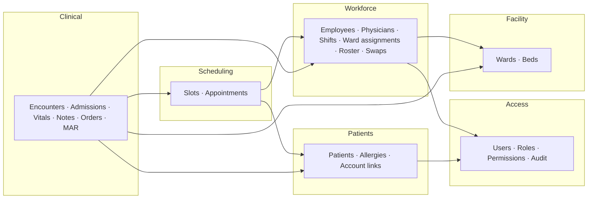

# Architecture

## 1. Goals

- **One system, not three.** One login, one staff record, one patient record, one ward list. Each feature reads from the same data.
- **Access is configured, not coded.** Admins decide what each role can do, and the code only checks permissions. See [RBAC.md](RBAC.md).
- **The database protects its own rules.** Double bookings, overlapping shifts and double-occupied beds are rejected by PostgreSQL, not just by app code.
- **Small, finished scope.** Each feature in scope gets built well, from end to end, before anything new is added.
- **Easy for reviewers.** It runs with `docker compose up`, has a demo account for each role, a CI badge, and docs like these.

## 2. Scope

### In scope

| Area | Feature | Origin |
|---|---|---|
| Access | Login, roles, permissions, scoped access | New (replaces 3 hardcoded role lists) |
| Access | Audit log of critical events, data changes and patient-record views, with viewer and patient access history | New (see [AUDIT.md](AUDIT.md)) |
| Workforce | Employees for all staff types, departments, positions | New (mantrix only knew nurses) |
| Workforce | Staff onboarding invites | hospital-care-system doctor invites, extended to all staff |
| Workforce | Physician profiles and specializations | hospital-care-system |
| Workforce | Shift definitions, ward assignments, duty roster | mantrix |
| Workforce | Shift swap requests (target accepts → head nurse approves) | mantrix |
| Facility | Wards and beds, live census | wardlink + mantrix (stations) |
| Patients | Patient registry, allergies | wardlink |
| Patients | Optional portal accounts, many-to-many with patients | hospital-care-system users, redesigned |
| Scheduling | Doctor availability slots, appointment requests, confirm/decline | hospital-care-system |
| Clinical | Encounters (outpatient visit or inpatient stay) | New: ties everything below together |
| Clinical | Admission, bed transfer, discharge | wardlink |
| Clinical | Vital signs (one model for outpatient and inpatient) | Both `vitals` tables merged |
| Clinical | Clinical notes (assessment, progress, nursing, discharge) | wardlink charts + hospital-care-system assessment fields |
| Clinical | Physician orders, medication administration linked to orders | wardlink |

### Deferred (phase 5, only after the core is done)

- Incident reports (mantrix)
- Performance evaluations (mantrix)
- Monthly roster pattern generator (mantrix)
- Notifications (email/in-app) for appointment and swap updates

### Cut

- **Inventory** (mantrix): a separate domain that would roughly double the scope.
- **Disease analytics / ward disease logs** (mantrix): can be derived from encounter diagnoses later if wanted.
- **Separate login pages per role** (wardlink): one login page. What the user sees depends on their permissions.

### Fixes over the old apps

- Staff names stored as free text (`recorded_by`, `physician_name`, `administered_by`) become foreign keys to `employees`.
- Patient `age` is calculated from `birth_date` instead of stored.
- Medication administration links to the physician order it fulfills.
- Blood pressure is stored as two integers (systolic/diastolic), not a string.
- Clinical records are never hard-deleted. Records entered in error are voided, with a reason.
- `cascadeOnDelete` on clinical data is removed. Deleting a ward or doctor must never erase patient history.

## 3. Modules

The app is a **modular monolith**: one deployable backend, split into modules with clear ownership. See [ADR 0001](adr/0001-modular-monolith.md).



Arrows mean "depends on". There are no cycles: Access and Facility are at the bottom and Clinical is at the top.

| Module | Owns | Postgres schema |
|---|---|---|
| Access | users, roles, role permissions, user roles, audit log | `access` |
| Workforce | departments, positions, employees, physician profiles, specializations, invites, shifts, ward assignments, roster, swaps | `workforce` |
| Facility | wards, beds | `facility` |
| Patients | patients, allergies, account links | `patients` |
| Scheduling | availability slots, appointments | `scheduling` |
| Clinical | encounters, admissions, bed assignments, vitals, notes, orders, medication administrations | `clinical` |

**Module rules**

1. Only the owning module writes to its tables.
2. Other modules can read through the owning module's public query service, or through read-only queries in simple list screens.
3. Foreign keys across schemas are allowed and encouraged, since data integrity matters more than strict isolation in a single app.
4. Architecture tests (NetArchTest) enforce rule 1 and the dependency direction above.
5. **When a lower module needs data from a higher one** (e.g. a ward's department: Facility needs Workforce), the lower module defines a small interface (`IDepartmentDirectory`) and the higher module implements and registers it. The cross-schema foreign key is configured in the higher module too (`WardDepartmentConfiguration` in Workforce), so the dependency still points one way.

## 4. How the modules connect: the main flow

One storyline runs through every module. It is also the demo script.

1. **HR** creates an employee (Dr. Santos, Physician, Internal Medicine) and sends an invite. Dr. Santos sets a password, and the account gets the *Physician* role.
2. **Dr. Santos** publishes availability slots for next week.
3. **A patient's daughter** registers a portal account and asks to be linked to her father's record. **Front desk** verifies the link (`relationship = representative`, `can_book = true`).
4. **The daughter** books a slot for her father. Dr. Santos confirms it.
5. On the day, **front desk** checks the patient in. That opens an **outpatient encounter**. A nurse records vitals, and Dr. Santos writes an assessment note.
6. Dr. Santos decides to admit. That opens an **inpatient encounter** with an admission to Ward 3, Bed 12.
7. The **Chief Nurse** has assigned Nurse Reyes to Ward 3. Nurse Reyes now sees the patient on the ward census, records vitals, and gives the medications Dr. Santos ordered.
8. Nurse Reyes requests a shift swap. The target nurse accepts, and the **Head Nurse** of Ward 3 approves.
9. The patient is transferred to Ward 5. The nurses on Ward 3 lose access, and the nurses on Ward 5 gain it, without anyone changing a setting.
10. Dr. Santos discharges the patient. The daughter can see the visit summary in the portal, because her link has `can_view_records = true`.

Every step is checked by a permission plus a scope (see [RBAC.md](RBAC.md)).

## 5. Backend

**Stack:** .NET 10 (LTS), ASP.NET Core Minimal APIs, EF Core 10 with Npgsql, PostgreSQL 18.

**Solution layout**

```
src/
  Hilom.Api/                 # host: startup, auth, middleware, OpenAPI
  Hilom.SharedKernel/        # base entity, Result, errors, clock, current-user abstraction
  Hilom.Infrastructure/      # AppDbContext, migrations, interceptors (audit, timestamps)
  Hilom.DemoData/            # demo mode: generated fictional hospital, demo logins, nightly reset (ADR 0009)
  Modules/
    Hilom.Access/
    Hilom.Workforce/
    Hilom.Facility/
    Hilom.Patients/
    Hilom.Scheduling/
    Hilom.Clinical/
tests/
  Hilom.ArchitectureTests/
  Hilom.IntegrationTests/    # Testcontainers PostgreSQL
  Hilom.UnitTests/
```

**Inside a module: one folder per feature (vertical slices)**

```
Hilom.Scheduling/
  Domain/            # entities, enums, domain rules
  Features/
    Appointments/
      BookAppointment.cs    # request, validator, handler, endpoint mapping in one file
      ConfirmAppointment.cs
      ListAppointments.cs
  Persistence/       # EF entity configurations for this module's tables
  SchedulingModule.cs  # registers services and endpoints
```

**Choices**

| Concern | Choice | Why |
|---|---|---|
| Endpoints | Minimal APIs, grouped per module | Less ceremony than controllers. Permissions attach to each endpoint. |
| Handlers | Plain classes injected into endpoints | No MediatR. It's now commercial-licensed, and a solo project doesn't need it. |
| Validation | FluentValidation | Validators sit next to the request they validate |
| Errors | RFC 7807 ProblemDetails | One error shape that the Angular side handles in one place |
| Data access | One `AppDbContext`, one Postgres schema per module | See [ADR 0001](adr/0001-modular-monolith.md) |
| Naming | `EFCore.NamingConventions` → snake_case | The schema reads like normal Postgres |
| IDs | UUID v7 (`Guid.CreateVersion7()`) | Ordered by time (good for indexes), safe to expose in URLs |
| Concurrency | Postgres `xmin` as the row version | Two users editing the same record get a conflict, not a silent overwrite |
| Time | `timestamptz` in UTC. Display uses the hospital time zone setting. | Night shifts cross midnight, and UTC keeps that sane |
| Auth | ASP.NET Core Identity for passwords and lockout, plus a cookie session | See [ADR 0005](adr/0005-cookie-auth.md) |
| Authorization | Custom permission policies with scopes | See [RBAC.md](RBAC.md) |
| Audit | Named events declared per endpoint, plus an EF interceptor for field diffs, plus sensitive-read logging, all in `access.audit_log` | Critical actions are traceable and can't be skipped. See [AUDIT.md](AUDIT.md). |
| API contract | Built-in OpenAPI document → generated Angular client | Frontend and backend types can't drift |
| Logging | Serilog, structured, with request IDs | |
| Database logins | Two: the **owner** (`ConnectionStrings:HilomOwner`) migrates, seeds and resets the demo; the **app** (`ConnectionStrings:Hilom`) serves requests as the restricted role `hilom_app` | The app can read and write module tables but only read and append to the audit log (AUDIT.md, rule 5). Locally, `HILOM_DB_APP_PASSWORD` in `.env` switches the API to `hilom_app`; Docker Compose gives it the login (`deploy/db/create-app-login.sh`). |
| Security headers | `SecurityHeaders` middleware on every API response: `Content-Security-Policy: default-src 'none'; frame-ancestors 'none'; …`, `X-Frame-Options: DENY`, `Referrer-Policy: strict-origin-when-cross-origin`, a `Permissions-Policy` denying camera, microphone, geolocation, payment and USB, `nosniff`, same-origin COOP/CORP. The Scalar page (outside production) gets no CSP so its scripts load. **HSTS** only when `Security:Hsts:Enabled=true`, so local HTTP never pins `localhost`. | The API answers JSON, so its policy allows nothing. The Angular app's server sends the app's own policy (below). |

## 6. Frontend

**Stack:** Angular 22 (standalone components, signals, new control flow), TypeScript strict mode, Tailwind CSS v4, Spartan UI on Angular CDK. Full conventions in [CONVENTIONS.md](CONVENTIONS.md).

```
web/src/app/
  core/          # auth service, permission service, HTTP interceptors, guards, layout shell
  ui/            # design system components (no business logic)
  api/           # generated client, never edited by hand
  features/
    access/  workforce/  facility/  patients/  scheduling/  clinical/  portal/
```

**Access in the UI**
- `PermissionService` reads permissions with scopes from `GET /api/access/me` after sign-in.
- `*appHasPermission="'clinical.vitals.record'"` structural directive hides controls.
- `permissionGuard('...')` on routes.
- The sidebar is built from permissions, not roles.
- **The UI hides what a user can't use. The API is what actually blocks it.**

**Design system:** Spartan UI components owned in `ui/`, semantic Tailwind tokens, Clinical Teal on slate, Inter, light and dark mode, WCAG 2.2 AA. Full spec in [DESIGN_SYSTEM.md](DESIGN_SYSTEM.md).

**The app's content security policy.** `default-src 'self'; script-src 'self' 'sha256-…'; style-src 'self' 'unsafe-inline'; img-src 'self' data:; font-src 'self'; connect-src 'self'; object-src 'none'; base-uri 'self'; form-action 'self'; frame-ancestors 'none'`, plus the same frame, referrer and permissions headers as the API. The hash allows the one inline script in `index.html` (it applies dark mode before first paint), so **changing that script means changing the hash** in `web/angular.json`; `e2e/security-headers.spec.ts` fails if they disagree. Styles need `'unsafe-inline'` because Angular adds component styles at runtime. Today the dev server sends it (`serve.options.headers`), so every e2e run checks it; whatever serves the built app in deployment (phase 5) must send the same headers.

## 7. Quality

| Layer | Tooling | What it proves |
|---|---|---|
| Unit | xUnit | Domain rules (swap state machine, slot overlap, dose validation) |
| Integration | xUnit + Testcontainers PostgreSQL + Respawn | Real SQL, real constraints, real auth |
| Authorization | Generated test matrix | Every endpoint × every default role behaves as RBAC.md says |
| Endpoint coverage | Reflection test | **Fails the build if any endpoint has no permission attached, or any state-changing endpoint has no audit event** |
| Audit | Integration tests | Each catalog event is written by its endpoint, inside the same transaction |
| Architecture | NetArchTest | Module dependency direction and write ownership |
| Frontend unit | Vitest | Services, guards, the permission directive |
| End-to-end | Playwright | The main flow in section 4, run as different roles |
| Static checks | `dotnet format`, analyzers as errors, ESLint, Prettier, `tsc --strict` | |
| CI | GitHub Actions | All of the above on every PR |

**Performance (4.4 quality pass).** Checked against the `Standard` demo (3.5k patients, 6.5k encounters, 64k vital signs, 419k audit entries): every read behind the census, patient search, audit viewer, day lists and dashboards, timed over HTTP and with `EXPLAIN ANALYZE`. Findings:

- **Audit viewer.** The page opens on `kind = event`, and counting that scanned the whole log; `(kind, occurred_at, id)` makes it an index-only scan. The "who" search matched users inside the log query, which also scanned every entry. Now it finds the matching users first and searches by `user_id = ANY(...)`, OR'ed with a partial index of failed sign-ins (288 ms → 5 ms in SQL). Who acted is a plain join on the user's key (it was a `ROW_NUMBER()` over all users on every page).
- **Census, day lists, encounters list.** Fine at this volume, but their plans read every past stay, slot or encounter. Partial indexes on open bed assignments and current admissions, an expression index on a slot's start (`lower(during)`), and `(started_at, id)` on encounters keep them proportional to what's on screen.
- **N+1.** No endpoint's query count grows with its rows. The one N+1 was in the browser: the staffing tile fetched every ward's roster to count heads. `GET /api/workforce/roster/staffing` returns the counts in one request.
- **Not changed.** Patient search scans 3.5k rows in 5 ms. Trigram (`pg_trgm`) GIN indexes on the four name/MRN expressions were tested and were *slower* at this size (9.5 ms); worth adding past roughly 50k patients. The unfiltered audit count is an index-only scan over the whole log (~20 ms at 419k); if the log grows into the millions, the page could show an estimate instead of an exact total.

## 8. Build phases

| Phase | Milestone |
|---|---|
| **0. Foundation** | An admin creates and assigns a role, the sidebar changes, and every step is in the audit log |
| **1. Workforce + Facility** | HR onboards a nurse, the Chief Nurse assigns them to a ward and rosters them |
| **2. Patients + Scheduling** | A representative books for a linked patient and the doctor confirms |
| **3. Clinical** | Main flow steps 5–10 pass in Playwright |
| **4. Polish + ship** | A stranger can try every role on the live demo |
| **5. Deferred** | Incidents, evaluations, roster patterns, notifications |

Slices, sizes and acceptance criteria are in [BUILD_PLAN.md](BUILD_PLAN.md).
