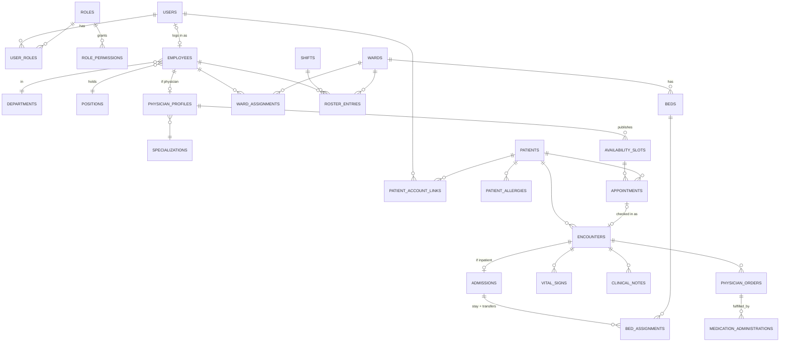

# Data Model

PostgreSQL 18. One schema per module. Names are snake_case.

## Conventions (apply to every table unless noted)

| Column | Type | Notes |
|---|---|---|
| `id` | `uuid` | UUID v7, generated by the app |
| `created_at`, `updated_at` | `timestamptz` | Set by an EF interceptor |
| `created_by`, `updated_by` | `uuid` → `access.users` | Nullable for system/seed actions |
| `xmin` | system column | Used as the concurrency token, not a real column |

- **Lookup/config tables** (departments, wards, shifts…) use `is_active` instead of being deleted.
- **Clinical tables** are never deleted or edited after a short window. Mistakes are voided: `voided_at`, `voided_by`, `void_reason`.
- **Foreign keys default to `ON DELETE RESTRICT`.** Nothing cascades into clinical data.
- **Enums** are stored as `text` with a `CHECK` constraint, not Postgres enum types. They're easier to change in migrations.
- **Extensions:** `citext` (case-insensitive email), `btree_gist` (exclusion constraints that mix equality and ranges).

## Overview

---

## `access` schema

### `users`
Who can log in. Has no profile data. That lives on `employees` or comes through patient links.

| Column | Type | Rules |
|---|---|---|
| email | `citext` | unique |
| password_hash, security_stamp, lockout fields | | Managed by ASP.NET Core Identity |
| display_name | `text` | |
| status | `text` | `active` / `disabled` |
| permissions_version | `int` | Bumped when the user's roles change. Forces a permission reload. |
| last_login_at | `timestamptz` | |

### `roles`
| Column | Type | Rules |
|---|---|---|
| name | `citext` | unique |
| description | `text` | |
| is_system | `bool` | `true` only for *System Administrator*: can't be deleted or have permissions removed |

### `role_permissions`
| Column | Type | Rules |
|---|---|---|
| role_id | `uuid` → roles | |
| permission | `text` | Must exist in the code catalog (checked on save and at startup) |
| scope | `text` | `all` / `ward` / `own` / `linked`. Must be one the catalog allows for that permission. |
| | | **PK (role_id, permission)**: one scope per permission per role |

### `user_roles`
`(user_id, role_id)` primary key, plus `assigned_by` and `assigned_at`.

### `audit_log`
See [AUDIT.md](AUDIT.md) for what gets logged and when. This table has no `updated_*` columns.

| Column | Type | Rules |
|---|---|---|
| occurred_at | `timestamptz` | |
| kind | `text` | `event` / `data_change` / `read` |
| event | `text` | From the event catalog, e.g. `clinical.patient.transferred`. For data changes: `data.changed`. |
| category | `text` | `auth` / `access` / `patients` / `scheduling` / `clinical` / `workforce` / `facility` |
| severity | `text` | `info` / `notice` / `critical` |
| outcome | `text` | `success` / `denied` / `failed` |
| user_id | `uuid` null | Who acted. Null for failed logins with an unknown email. |
| attempted_identifier | `citext` null | Email typed on a failed login |
| patient_id | `uuid` null | The patient this concerns, if any. Powers the patient access history. |
| acting_for_patient_link_id | `uuid` null | Set when a portal user acts through a patient link |
| entity_type, entity_id | `text`, `uuid` | The record affected |
| changes | `jsonb` null | `{ "field": [old, new] }` for data changes |
| details | `jsonb` null | Event-specific facts, e.g. `{ "from_ward": "W3", "to_ward": "W5", "reason": "…" }` |
| correlation_id | `text` | The request ID. Groups an event with its data changes. |
| ip_address | `inet` | |
| user_agent | `text` | |
| prev_hash, hash | `bytea` null | Filled by the sealing job (tamper evidence) |
| sealed_at | `timestamptz` null | |

- Only inserts are allowed. The trigger `audit_log_append_only` rejects `UPDATE` and `DELETE` (and `audit_log_no_truncate` rejects `TRUNCATE`) for every database role, including the owner. The one exception: filling `prev_hash`, `hash` and `sealed_at` on a row where `sealed_at` is null, for the sealing job. In deployment the app's role also gets only `INSERT` and `SELECT` on the table.
- Indexes: `(occurred_at)`, `(user_id, occurred_at)`, `(patient_id, occurred_at)`, `(event, occurred_at)`, and partial `(occurred_at) WHERE severity = 'critical'`.

---

## `workforce` schema

### `departments`, `positions`
Simple lookups: `name` (unique), `is_active`. Example positions: Staff Nurse, Head Nurse, Chief Nurse, Resident Physician, Consultant, HR Officer, Front Desk Officer.

### `employees`
Everyone who works at the hospital, whether or not they log in.

| Column | Type | Rules |
|---|---|---|
| employee_no | `text` | unique, e.g. `EMP-2026-0042`: the year it was created (hospital time) and a number from `workforce.employee_number_seq`, which never resets |
| user_id | `uuid` → users, null | **unique**. An employee who never logs in has none. |
| first_name, middle_name, last_name | `text` | |
| sex | `text` | `male` / `female` |
| birth_date | `date` | |
| contact_number, email | `text`, `citext` | Work contact, separate from the login email. Both optional. |
| department_id | → departments | |
| position_id | → positions | |
| professional_type | `text` | `physician` / `nurse` / `allied_health` / `administrative` |
| license_number | `text` null | Required by check when type is `physician` or `nurse` |
| employment_type | `text` | `full_time` / `part_time` / `contract` |
| hired_on | `date` | |
| status | `text` | `active` / `on_leave` / `separated` |
| separated_on | `date` null | Check: set exactly when status is `separated` |

### `specializations`
`name` (unique), `is_active`. Taken from hospital-care-system.

### `physician_profiles`
| Column | Type | Rules |
|---|---|---|
| employee_id | → employees | **PK**. Check: the employee's type is `physician` (enforced in the app). Changing an employee to another type removes the profile. |
| specialization_id | → specializations | |
| accepts_appointments | `bool` | Controls whether the doctor appears in the booking UI |
| consultation_minutes | `int` | Default slot length. Check: 5–240, default 30. |

### `staff_invites`
Generalized from hospital-care-system's `doctor_invites`.

| Column | Type | Rules |
|---|---|---|
| employee_id | → employees | The employee the new account will be linked to |
| email | `citext` | |
| token_hash | `bytea` | SHA-256 of a random 32-byte token, unique. Only the hash is stored; the token goes out by email once, after `#` in the link so it stays out of server logs. |
| initial_role_ids | `uuid[]` | Roles granted when accepted. Roles deleted in the meantime are skipped. |
| expires_at, accepted_at, revoked_at | `timestamptz` | Valid for 7 days by default (`Workforce:Invites:ValidFor`). Check: not both accepted and revoked. |
| | | Partial unique: one open invite per employee (`accepted_at IS NULL AND revoked_at IS NULL`). Sending a new invite closes an expired open one. |

### `shifts`
From mantrix.

| Column | Type | Rules |
|---|---|---|
| code | `citext` | unique, e.g. `AM`, `PM`, `NOC`. Stored upper-case; letters and digits. |
| name | `text` | |
| starts_at, ends_at | `time` | `ends_at < starts_at` means it crosses midnight. Check: they differ. Length is computed (22:00–06:00 = 8 h). |
| color | `text` | `am` / `pm` / `noc`, which pick the `shift-am` / `shift-pm` / `shift-noc` tokens (not hex), so every shift color passes contrast |
| sort_order | `int` | Roster order. New shifts go last unless given. |
| is_active | `bool` | Deactivated, never deleted: roster entries use it |

### `ward_assignments`
Which ward an employee belongs to over a period. Replaces mantrix's `station_assignments` and `ward_nurse`. **This drives the `ward` scope in RBAC.**

| Column | Type | Rules |
|---|---|---|
| employee_id | → employees | |
| ward_id | → facility.wards | |
| period | `daterange` | `[start, end)`. Open-ended when the end is null. The API speaks in `startsOn` and an inclusive `lastDay` (stored as `lastDay + 1`). Check: not empty, has a start. Assignments are shortened, never extended past an existing end. |
| reason | `text` null | |
| assigned_by | → users | |
| | | **EXCLUDE USING gist (employee_id WITH =, period WITH &&)** (`ex_ward_assignments_one_ward_at_a_time`, created in raw SQL): one ward at a time per employee. The API checks first to name the conflicting ward in a 409, and maps a race that only the constraint catches to the same 409. |

**Decided:** one ward at a time. If floating nurses are needed later, drop the exclusion to allow overlaps.

### `roster_entries`
The duty roster: who works which shift, where, on which day. Replaces `nurse_schedules`.

| Column | Type | Rules |
|---|---|---|
| employee_id | → employees | |
| ward_id | → facility.wards | |
| shift_id | → shifts | |
| duty_date | `date` | |
| status | `text` | `scheduled` / `swapped_out` / `absent` |
| | | Unique `(employee_id, duty_date)` where status = `scheduled`: one shift per day |

### `shift_swap_requests`
mantrix's two-step workflow, simplified to a single state field.

| Column | Type | Rules |
|---|---|---|
| requester_entry_id | → roster_entries | |
| target_entry_id | → roster_entries | |
| message | `text` | |
| status | `text` | `pending_target` → `pending_approval` → `approved` / `declined_by_target` / `rejected` / `cancelled` |
| target_responded_at, target_response | | |
| reviewed_by, reviewed_at, review_note | | Reviewer needs `workforce.swaps.approve` on that ward |
| | | On `approved`: both entries swap employees in one transaction |

---

## `facility` schema

### `wards`
| Column | Type | Rules |
|---|---|---|
| code | `citext` | unique, e.g. `W3`. Stored upper-case; letters, digits and dashes. Listed in natural order (W2 before W10). |
| name | `text` | |
| ward_type | `text` | `general` / `pediatric` / `icu` / `maternity` / `surgical` / `isolation` |
| department_id | → workforce.departments, null | New or changed department must be active. The FK is configured by Workforce (ARCHITECTURE.md §3, rule 5). |
| is_active | `bool` | |

Capacity is **not stored**. It's the count of active beds in an active ward.

### `beds`
| Column | Type | Rules |
|---|---|---|
| ward_id | → wards | |
| label | `citext` | Unique within ward (ignoring case). Listed in natural order (Bed 2 before Bed 10). |
| is_active | `bool` | Out-of-service beds are inactive |

Bed occupancy is **not stored on the bed**. It comes from `clinical.bed_assignments`.

---

## `patients` schema

### `patients`
| Column | Type | Rules |
|---|---|---|
| mrn | `text` | unique, medical record number, e.g. `MRN-000123` |
| first_name, middle_name, last_name | `text` | |
| birth_date | `date` | Age is calculated |
| sex | `text` | check |
| civil_status, religion | `text` null | |
| address, contact_number | `text` | |
| emergency_contact_name, emergency_contact_relation, emergency_contact_number | `text` | |
| registered_by | → users | |

### `patient_allergies`
| Column | Type | Rules |
|---|---|---|
| patient_id | → patients | |
| allergen | `text` | |
| category | `text` | `drug` / `food` / `environmental` / `other` |
| severity | `text` | `mild` / `moderate` / `severe` |
| reaction | `text` | |
| status | `text` | `active` / `resolved` / `entered_in_error` |

### `patient_account_links`
Optional, many-to-many, verified by staff. See [ADR 0003](adr/0003-patient-account-links.md).

| Column | Type | Rules |
|---|---|---|
| user_id | → access.users | |
| patient_id | → patients | |
| relationship | `text` | `self` / `parent` / `guardian` / `spouse` / `child` / `representative` |
| can_book | `bool` | |
| can_view_records | `bool` | |
| status | `text` | `pending` / `active` / `rejected` / `revoked` |
| requested_at | `timestamptz` | |
| verified_by, verified_at | → users | Needs `patients.links.manage` |
| revoked_by, revoked_at, revoke_reason | | |
| | | Partial unique `(user_id, patient_id)` where status in (`pending`, `active`) |
| | | Partial unique `(patient_id)` where relationship = `self` and status = `active`: at most one self account |

---

## `scheduling` schema

### `availability_slots`
What a physician offers. Bookable time.

| Column | Type | Rules |
|---|---|---|
| physician_id | → workforce.physician_profiles | |
| during | `tstzrange` | |
| status | `text` | `open` / `closed` (closed by the doctor; booked-ness comes from appointments) |
| | | **EXCLUDE USING gist (physician_id WITH =, during WITH &&)**: a doctor's slots never overlap |
| | | Check: `upper(during) > lower(during)` |

### `appointments`
| Column | Type | Rules |
|---|---|---|
| slot_id | → availability_slots | |
| patient_id | → patients.patients | |
| booked_by | → access.users | The patient, a representative, or staff |
| reason | `text` | Chief complaint |
| status | `text` | `requested` → `confirmed` → `checked_in` → `completed`; also `declined`, `cancelled`, `no_show` |
| decided_by, decided_at, decision_note | | |
| cancelled_by, cancelled_at, cancel_reason | | |
| | | Partial unique `(slot_id)` where status in (`requested`, `confirmed`, `checked_in`, `completed`): one live appointment per slot |

The old app let several requests queue on one slot. Here, one request holds the slot until it's declined or cancelled. **Decided:** no waitlist.

---

## `clinical` schema

See [ADR 0004](adr/0004-encounter-as-clinical-spine.md) for why everything hangs off `encounters`.

### `encounters`
| Column | Type | Rules |
|---|---|---|
| patient_id | → patients.patients | |
| encounter_type | `text` | `outpatient` / `inpatient` |
| appointment_id | → scheduling.appointments, null | unique. Set when it started from a check-in. |
| parent_encounter_id | → encounters, null | An inpatient stay admitted from an outpatient visit |
| attending_physician_id | → workforce.physician_profiles | Drives the `own` scope for doctors |
| chief_complaint | `text` | |
| diagnosis_summary | `text` | Free text for now (structured coding is out of scope) |
| status | `text` | `open` / `closed` / `voided` |
| started_at, ended_at | `timestamptz` | |

### `admissions`
One per inpatient encounter.

| Column | Type | Rules |
|---|---|---|
| encounter_id | → encounters | **PK** |
| admitted_at | `timestamptz` | |
| admitting_diagnosis | `text` | |
| reason | `text` | |
| discharged_at | `timestamptz` null | |
| discharge_disposition | `text` null | `home` / `transferred_out` / `against_advice` / `expired` |
| discharged_by | → users | |
| | | **A patient can't be admitted twice at once.** Enforced with an exclusion on `(patient_id, tstzrange(admitted_at, discharged_at))`. `patient_id` is copied onto this table so the constraint can use it. |

### `bed_assignments`
Where an admitted patient is. **Transfers are a new row.** This replaces wardlink's `patient_transfers` and the duplicated `ward_id` on patients.

| Column | Type | Rules |
|---|---|---|
| admission_id | → admissions | |
| bed_id | → facility.beds | |
| ward_id | → facility.wards | Copied from bed for fast ward-scope queries (check matches bed) |
| during | `tstzrange` | Open upper bound = currently there |
| reason | `text` | Admission, transfer reason |
| moved_by | → users | |
| | | **EXCLUDE (bed_id WITH =, during WITH &&)**: no two patients in one bed |
| | | **EXCLUDE (admission_id WITH =, during WITH &&)**: a patient is in one bed at a time |

A transfer is one transaction: close the current row's range, then insert the new one.

### `vital_signs`
Merges hospital-care-system `vitals` and wardlink `vital_signs`.

| Column | Type | Rules |
|---|---|---|
| encounter_id | → encounters | |
| recorded_at | `timestamptz` | |
| recorded_by | → workforce.employees | |
| temperature_c | `numeric(4,1)` | check 30–45 |
| systolic_bp, diastolic_bp | `smallint` | check plausible ranges |
| heart_rate, respiratory_rate | `smallint` | |
| oxygen_saturation | `smallint` | check 0–100 |
| pain_score | `smallint` null | 0–10 |
| weight_kg, height_cm | `numeric(5,2)` null | BMI is calculated, not stored |
| notes | `text` | |
| voided_at, voided_by, void_reason | | |

### `clinical_notes`
Replaces wardlink `patient_charts` and hospital-care-system's assessment/diagnostic/treatment/diet/remarks text columns.

| Column | Type | Rules |
|---|---|---|
| encounter_id | → encounters | |
| note_type | `text` | `assessment` / `progress` / `nursing` / `diet` / `discharge_summary` |
| body | `text` | |
| authored_by | → workforce.employees | |
| authored_at | `timestamptz` | |
| voided_at, voided_by, void_reason | | |

Notes can't be edited after 24 hours. Corrections are new notes, and the old one is voided.

### `physician_orders`
| Column | Type | Rules |
|---|---|---|
| encounter_id | → encounters | |
| ordered_by | → workforce.physician_profiles | |
| ordered_at | `timestamptz` | |
| order_type | `text` | `medication` / `laboratory` / `diet` / `nursing` / `other` |
| details | `text` | |
| medication_name, dose, route, frequency | `text` null | Required by check when `order_type = 'medication'` |
| status | `text` | `active` / `completed` / `discontinued` |
| discontinued_by, discontinued_at, discontinue_reason | | |

### `medication_administrations`
The MAR. Each row is linked to the order it carries out.

| Column | Type | Rules |
|---|---|---|
| order_id | → physician_orders | Must be a `medication` order that is `active` (app rule) |
| administered_at | `timestamptz` | |
| administered_by | → workforce.employees | |
| dose_given | `text` | |
| outcome | `text` | `given` / `held` / `refused` / `not_available` |
| notes | `text` | Required when outcome isn't `given` |
| voided_at, voided_by, void_reason | | |

---

## Derived views (read models)

| View | Purpose |
|---|---|
| `clinical.current_census` | Every open bed assignment with patient, ward, bed, attending physician, and admitted hours. Powers the ward board. |
| `scheduling.open_slots` | Slots with `status = open`, no live appointment, starting in the future |
| `workforce.current_ward_staff` | Employees whose `ward_assignments.period` contains today |

## What enforces what

| Rule | Enforced by |
|---|---|
| Doctor slots don't overlap | Exclusion constraint |
| One live appointment per slot | Partial unique index |
| No two patients in one bed | Exclusion constraint |
| Patient in one bed / one admission at a time | Exclusion constraints |
| Employee in one ward at a time | Exclusion constraint |
| One shift per employee per day | Partial unique index |
| One active self-link per patient | Partial unique index |
| Medication orders have dose/route | Check constraint |
| Vitals are in plausible ranges | Check constraints |
| Audit log is append-only | Database grants (separate role for sealing) |
| Every state-changing endpoint is audited | Build-time test (see AUDIT.md) |
| Swap/appointment state transitions | Domain code + unit tests |
| Scope (who can see which record) | Application (see RBAC.md) |
