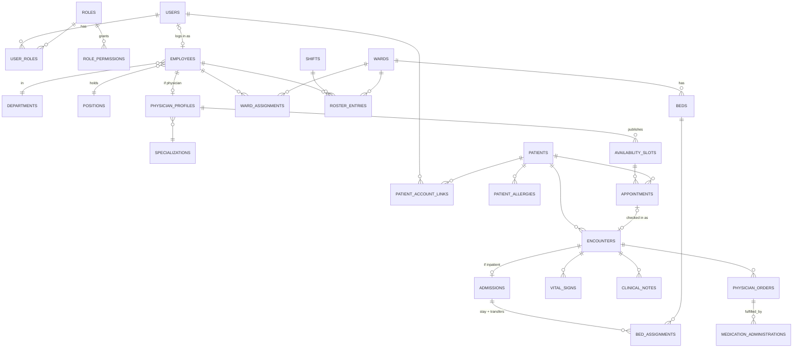

# Data Model

PostgreSQL 18. One schema per module. Names are snake_case.

## Conventions (apply to every table unless noted)

| Column | Type | Notes |
|---|---|---|
| `id` | `uuid` | UUID v7, generated by the app |
| `created_at`, `updated_at` | `timestamptz` | Set by an EF interceptor |
| `created_by`, `updated_by` | `uuid` → `access.users` | Nullable for system/seed actions |
| `xmin` | system column | Used as the concurrency token, not a real column |

- **Lookup/config tables** (departments, wards, shifts…) use `is_active` instead of being deleted.
- **Clinical tables** are never deleted or edited after a short window. Mistakes are voided: `voided_at`, `voided_by`, `void_reason`.
- **Foreign keys default to `ON DELETE RESTRICT`.** Nothing cascades into clinical data.
- **Enums** are stored as `text` with a `CHECK` constraint, not Postgres enum types. They're easier to change in migrations.
- **Extensions:** `citext` (case-insensitive email), `btree_gist` (exclusion constraints that mix equality and ranges).

## Overview

---

## `access` schema

### `users`
Who can log in. Has no profile data. That lives on `employees` or comes through patient links.

| Column | Type | Rules |
|---|---|---|
| email | `citext` | unique |
| password_hash, security_stamp, lockout fields | | Managed by ASP.NET Core Identity |
| display_name | `text` | |
| account_type | `text` | `staff` (made by an administrator or a staff invite) / `portal` (self-registered by a patient or family member). Never changes. |
| status | `text` | `active` / `disabled` |
| permissions_version | `int` | Bumped when the user's roles change. Forces a permission reload. |
| last_login_at | `timestamptz` | |

### `roles`
| Column | Type | Rules |
|---|---|---|
| name | `citext` | unique |
| description | `text` | |
| is_system | `bool` | `true` only for *System Administrator*: can't be deleted or have permissions removed |
| is_portal | `bool` | `true` only for the role new portal accounts get (*Patient Portal User* by default). Partial unique index. Can be edited, not deleted. |

### `role_permissions`
| Column | Type | Rules |
|---|---|---|
| role_id | `uuid` → roles | |
| permission | `text` | Must exist in the code catalog (checked on save and at startup) |
| scope | `text` | `all` / `ward` / `own` / `linked`. Must be one the catalog allows for that permission. |
| | | **PK (role_id, permission)**: one scope per permission per role |

### `user_roles`
`(user_id, role_id)` primary key, plus `assigned_by` and `assigned_at`.

### `audit_log`
See [AUDIT.md](AUDIT.md) for what gets logged and when. This table has no `updated_*` columns.

| Column | Type | Rules |
|---|---|---|
| occurred_at | `timestamptz` | |
| kind | `text` | `event` / `data_change` / `read` |
| event | `text` | From the event catalog, e.g. `clinical.patient.transferred`. For data changes: `data.changed`. |
| category | `text` | `auth` / `access` / `patients` / `scheduling` / `clinical` / `workforce` / `facility` |
| severity | `text` | `info` / `notice` / `critical` |
| outcome | `text` | `success` / `denied` / `failed` |
| user_id | `uuid` null | Who acted. Null for failed logins with an unknown email. |
| attempted_identifier | `citext` null | Email typed on a failed login |
| patient_id | `uuid` null | The patient this concerns, if any. Powers the patient access history. |
| acting_for_patient_link_id | `uuid` null | Set when a portal user acts through a patient link |
| entity_type, entity_id | `text`, `uuid` | The record affected |
| changes | `jsonb` null | `{ "field": [old, new] }` for data changes |
| details | `jsonb` null | Event-specific facts, e.g. `{ "from_ward": "W3", "to_ward": "W5", "reason": "…" }` |
| correlation_id | `text` | The request ID. Groups an event with its data changes. |
| ip_address | `inet` | |
| user_agent | `text` | |
| prev_hash, hash | `bytea` null | Filled by the sealing job (tamper evidence) |
| sealed_at | `timestamptz` null | |

- Only inserts are allowed. The trigger `audit_log_append_only` rejects `UPDATE` and `DELETE` (and `audit_log_no_truncate` rejects `TRUNCATE`) for every database role, including the owner. The one exception: filling `prev_hash`, `hash` and `sealed_at` on a row where `sealed_at` is null, for the sealing job. In deployment the app's role also gets only `INSERT` and `SELECT` on the table.
- Indexes: `(occurred_at)`, `(user_id, occurred_at)`, `(patient_id, occurred_at)`, `(event, occurred_at)`, and partial `(occurred_at) WHERE severity = 'critical'`. *Added in 4.4:* `(kind, occurred_at, id)` (the audit page opens on `kind = event`) and partial `(occurred_at) WHERE attempted_identifier IS NOT NULL` (the "who" search over failed sign-ins). Other 4.4 indexes: partial `bed_assignments (ward_id) WHERE upper_inf(during)` and `admissions (encounter_id) WHERE discharged_at IS NULL` for the census view, `availability_slots (lower(during))` for day lists, `encounters (started_at, id)` for the encounters list. See ARCHITECTURE.md §7, performance.
- *Built in 4.2:* the sealing job fills `prev_hash`, `hash` and `sealed_at` (see AUDIT.md, rule 6). Two partial indexes serve it: `ix_audit_log_chain_order` on `(sealed_at, occurred_at, id) WHERE sealed_at IS NOT NULL` (the chain order) and `ix_audit_log_unsealed` on `(occurred_at, id) WHERE sealed_at IS NULL` (what's waiting to be sealed).

---

## `workforce` schema

### `departments`, `positions`
Simple lookups: `name` (unique), `is_active`. Example positions: Staff Nurse, Head Nurse, Chief Nurse, Resident Physician, Consultant, HR Officer, Front Desk Officer.

### `employees`
Everyone who works at the hospital, whether or not they log in.

| Column | Type | Rules |
|---|---|---|
| employee_no | `text` | unique, e.g. `EMP-2026-0042`: the year it was created (hospital time) and a number from `workforce.employee_number_seq`, which never resets |
| user_id | `uuid` → users, null | **unique**. An employee who never logs in has none. |
| first_name, middle_name, last_name | `text` | |
| sex | `text` | `male` / `female` |
| birth_date | `date` | |
| contact_number, email | `text`, `citext` | Work contact, separate from the login email. Both optional. |
| department_id | → departments | |
| position_id | → positions | |
| professional_type | `text` | `physician` / `nurse` / `allied_health` / `administrative` |
| license_number | `text` null | Required by check when type is `physician` or `nurse` |
| employment_type | `text` | `full_time` / `part_time` / `contract` |
| hired_on | `date` | |
| status | `text` | `active` / `on_leave` / `separated` |
| separated_on | `date` null | Check: set exactly when status is `separated` |

### `specializations`
`name` (unique), `is_active`. Taken from hospital-care-system.

### `physician_profiles`
| Column | Type | Rules |
|---|---|---|
| employee_id | → employees | **PK**. Check: the employee's type is `physician` (enforced in the app). Changing an employee to another type removes the profile. |
| specialization_id | → specializations | |
| accepts_appointments | `bool` | Controls whether the doctor appears in the booking UI |
| consultation_minutes | `int` | Default slot length. Check: 5–240, default 30. |

### `staff_invites`
Generalized from hospital-care-system's `doctor_invites`.

| Column | Type | Rules |
|---|---|---|
| employee_id | → employees | The employee the new account will be linked to |
| email | `citext` | |
| token_hash | `bytea` | SHA-256 of a random 32-byte token, unique. Only the hash is stored; the token goes out by email once, after `#` in the link so it stays out of server logs. |
| initial_role_ids | `uuid[]` | Roles granted when accepted. Roles deleted in the meantime are skipped. |
| expires_at, accepted_at, revoked_at | `timestamptz` | Valid for 7 days by default (`Workforce:Invites:ValidFor`). Check: not both accepted and revoked. |
| | | Partial unique: one open invite per employee (`accepted_at IS NULL AND revoked_at IS NULL`). Sending a new invite closes an expired open one. |

### `shifts`
From mantrix.

| Column | Type | Rules |
|---|---|---|
| code | `citext` | unique, e.g. `AM`, `PM`, `NOC`. Stored upper-case; letters and digits. |
| name | `text` | |
| starts_at, ends_at | `time` | `ends_at < starts_at` means it crosses midnight. Check: they differ. Length is computed (22:00–06:00 = 8 h). |
| color | `text` | `am` / `pm` / `noc`, which pick the `shift-am` / `shift-pm` / `shift-noc` tokens (not hex), so every shift color passes contrast |
| sort_order | `int` | Roster order. New shifts go last unless given. |
| is_active | `bool` | Deactivated, never deleted: roster entries use it |

### `ward_assignments`
Which ward an employee belongs to over a period. Replaces mantrix's `station_assignments` and `ward_nurse`. **This drives the `ward` scope in RBAC.**

| Column | Type | Rules |
|---|---|---|
| employee_id | → employees | |
| ward_id | → facility.wards | |
| period | `daterange` | `[start, end)`. Open-ended when the end is null. The API speaks in `startsOn` and an inclusive `lastDay` (stored as `lastDay + 1`). Check: not empty, has a start. Assignments are shortened, never extended past an existing end. |
| reason | `text` null | |
| assigned_by | → users | |
| | | **EXCLUDE USING gist (employee_id WITH =, period WITH &&)** (`ex_ward_assignments_one_ward_at_a_time`, created in raw SQL): one ward at a time per employee. The API checks first to name the conflicting ward in a 409, and maps a race that only the constraint catches to the same 409. |

**Decided:** one ward at a time. If floating nurses are needed later, drop the exclusion to allow overlaps.

### `roster_entries`
The duty roster: who works which shift, where, on which day. Replaces `nurse_schedules`.

| Column | Type | Rules |
|---|---|---|
| employee_id | → employees | |
| ward_id | → facility.wards | |
| shift_id | → shifts | |
| duty_date | `date` | |
| status | `text` | `scheduled` / `swapped_out` / `absent`. `swapped_out` is set by approved swaps (1.8). |
| | | Unique `(employee_id, duty_date)` where status = `scheduled` (`ux_roster_entries_one_shift_per_day`): one shift per day. The API names the existing shift in a 409. |
| | | The API only rosters someone on a ward they're assigned to that day (422 `not_assigned_to_ward`), and only with an active shift. Removing an entry deletes it (planning data); the audit log keeps what it was. |

### `shift_swap_requests`
mantrix's two-step workflow, simplified to a single state field.

| Column | Type | Rules |
|---|---|---|
| requester_entry_id, target_entry_id | → roster_entries, null | `ON DELETE SET NULL`, so history outlives a removed entry. An entry in an **open** swap can't be changed or removed (409 `entry_in_open_swap`). Partial unique per column while open. |
| requester_employee_id, target_employee_id, ward_id | → employees, → facility.wards | Snapshot of who and where. Check: two different people. Both shifts are on the same ward. |
| requester_duty_date, requester_shift_id, target_duty_date, target_shift_id | `date`, → shifts | Snapshot of the two shifts, so the swap reads the same later |
| message | `text` null | |
| status | `text` | `pending_target` → `pending_approval` → `approved` / `declined_by_target` / `rejected` / `cancelled` (the requester can cancel while open) |
| target_responded_at, target_response | | |
| reviewed_by, reviewed_at, review_note | | Reviewer needs `workforce.swaps.approve` on that ward |
| | | **On `approved`**, in one transaction: both original entries become `swapped_out`, and two new `scheduled` entries are created with the people exchanged. (Swapping `employee_id` in place would trip the one-shift-per-day index mid-update for same-day swaps, and would lose who originally held the shift.) Approval re-checks that both entries are unchanged, both people are assigned to the ward on their new day, and neither ends up with two shifts that day. |

---

## `facility` schema

### `wards`
| Column | Type | Rules |
|---|---|---|
| code | `citext` | unique, e.g. `W3`. Stored upper-case; letters, digits and dashes. Listed in natural order (W2 before W10). |
| name | `text` | |
| ward_type | `text` | `general` / `pediatric` / `icu` / `maternity` / `surgical` / `isolation` |
| department_id | → workforce.departments, null | New or changed department must be active. The FK is configured by Workforce (ARCHITECTURE.md §3, rule 5). |
| is_active | `bool` | |

Capacity is **not stored**. It's the count of active beds in an active ward.

### `beds`
| Column | Type | Rules |
|---|---|---|
| ward_id | → wards | |
| label | `citext` | Unique within ward (ignoring case). Listed in natural order (Bed 2 before Bed 10). |
| is_active | `bool` | Out-of-service beds are inactive |

Bed occupancy is **not stored on the bed**. It comes from `clinical.bed_assignments`.

---

## `patients` schema

### `patients`
| Column | Type | Rules |
|---|---|---|
| mrn | `text` | unique, medical record number, e.g. `MRN-000123`, from a never-reset sequence |
| first_name, middle_name, last_name | `text` | |
| birth_date | `date` | Age is calculated |
| sex | `text` | check: `male` / `female` (same values as employees) |
| civil_status | `text` null | check: `single` / `married` / `widowed` / `separated` / `annulled` |
| religion | `text` null | |
| address, contact_number | `text` | |
| emergency_contact_name, emergency_contact_relation, emergency_contact_number | `text` | |
| | | Who registered the patient, and when, is `created_by` / `created_at` |

### `patient_allergies`
| Column | Type | Rules |
|---|---|---|
| patient_id | → patients | |
| allergen | `text` | |
| category | `text` | `drug` / `food` / `environmental` / `other` |
| severity | `text` | `mild` / `moderate` / `severe` |
| reaction | `text` null | Empty when unknown |
| status | `text` | `active` / `resolved` / `entered_in_error`. Entries are never deleted; only active ones can be edited. |
| status_note | `text` null | Why it was resolved or entered in error. Required (check) for `entered_in_error`. |
| | | Partial unique `(patient_id, allergen)` where status = `active`, allergen `citext`: one active entry per allergen, ignoring case |

### `patient_account_links`
Optional, many-to-many, verified by staff. See [ADR 0003](adr/0003-patient-account-links.md).

A portal user requests a link by describing the patient as they know them. Front desk staff find the matching record, check the requester's ID, and verify. So a request reveals nothing about which patients exist, and `patient_id` is only set once staff match it.

| Column | Type | Rules |
|---|---|---|
| user_id | → access.users | The portal account |
| patient_id | → patients, null | Set by staff when verifying. Check: required unless `pending` or `rejected`. |
| requested_patient_name, requested_birth_date, requested_mrn | `text`, `date`, `text` null | The patient as the requester described them |
| relationship | `text` | What the account holder is to the patient: `self` / `parent` / `guardian` / `spouse` / `child` / `representative`. A daughter linking her father is `child`. Requested, then confirmed by staff. |
| request_note | `text` null | From the requester |
| can_book | `bool` | |
| can_view_records | `bool` | Needed for `linked` record access (`patients.view`, and the portal records view `clinical.encounters.view`) |
| status | `text` | `pending` / `active` / `rejected` / `revoked` |
| requested_at | `timestamptz` | |
| reviewed_by, reviewed_at, review_note | → users | Who verified or rejected it (needs `patients.links.manage`). A rejection's note is shown to the requester. |
| revoked_by, revoked_at, revoke_reason | | Reason required (check). Not shown to the account holder. |
| | | Partial unique `(user_id, patient_id)` where status in (`pending`, `active`) |
| | | Partial unique `(patient_id)` where relationship = `self` and status = `active`: at most one self account |
| | | A portal account can have at most 5 pending requests (API) |

---|---|---|
| user_id | → access.users | |
| patient_id | → patients | |
| relationship | `text` | `self` / `parent` / `guardian` / `spouse` / `child` / `representative` |
| can_book | `bool` | |
| can_view_records | `bool` | |
| status | `text` | `pending` / `active` / `rejected` / `revoked` |
| requested_at | `timestamptz` | |
| verified_by, verified_at | → users | Needs `patients.links.manage` |
| revoked_by, revoked_at, revoke_reason | | |
| | | Partial unique `(user_id, patient_id)` where status in (`pending`, `active`) |
| | | Partial unique `(patient_id)` where relationship = `self` and status = `active`: at most one self account |

---

## `scheduling` schema

### `availability_slots`
What a physician offers. Bookable time.

| Column | Type | Rules |
|---|---|---|
| physician_id | → workforce.physician_profiles (employee_id) | Foreign key added in SQL, since the profile is an owned type |
| during | `tstzrange` | Half-open `[start, end)`, stored in UTC, published in hospital time |
| status | `text` | `open` / `closed` (closed by the doctor or front desk; booked-ness comes from appointments) |
| | | **EXCLUDE USING gist (physician_id WITH =, during WITH &&) WHERE (status = 'open')**: a doctor's open slots never overlap. Closed slots are history, so the time can be offered again. |
| | | Check: bounded and non-empty (`upper(during) > lower(during)`) |

Slots are published from a weekly pattern (date range of up to 12 weeks, days of the week, a daily window, minutes per slot defaulting to the physician's consultation length). Slots that would overlap the physician's open slots are skipped, at most 500 per publish, and only physicians who accept appointments can publish.

### `appointments`
| Column | Type | Rules |
|---|---|---|
| slot_id | → availability_slots | |
| patient_id | → patients.patients | |
| booked_by | → access.users | The patient, a representative, or staff |
| reason | `text` | Chief complaint |
| status | `text` | `requested` → `confirmed` → `checked_in` → `completed`; also `declined`, `cancelled`, `no_show` |
| decided_by, decided_at, decision_note | | |
| cancelled_by, cancelled_at, cancel_reason | | |
| | | Partial unique `(slot_id)` where status in (`requested`, `confirmed`, `checked_in`, `completed`): one live appointment per slot |

The old app let several requests queue on one slot. Here, one request holds the slot until it's declined or cancelled. **Decided:** no waitlist.

*Built in 2.6–2.7:* everything above. Transitions: `requested` → `confirmed` or `declined` (decline needs a reason, shown to the patient's side; check constraint), `requested`/`confirmed` → `cancelled` before the visit starts (reason required; check constraint), `confirmed` → `no_show` once it has started. Declined and cancelled appointments free the slot. `checked_in` and `completed` come with encounters (built in 3.1, see below). Only open, upcoming slots of physicians who take appointments can be booked; a portal user books only through an active link with `can_book`, and the audit entry names that link.

---

## `clinical` schema

See [ADR 0004](adr/0004-encounter-as-clinical-spine.md) for why everything hangs off `encounters`.

### `encounters`
| Column | Type | Rules |
|---|---|---|
| patient_id | → patients.patients | |
| encounter_type | `text` | `outpatient` / `inpatient` |
| appointment_id | → scheduling.appointments, null | unique. Set when it started from a check-in. |
| parent_encounter_id | → encounters, null | An inpatient stay admitted from an outpatient visit |
| attending_physician_id | → workforce.physician_profiles | Drives the `own` scope for doctors |
| chief_complaint | `text` | |
| diagnosis_summary | `text` | Free text for now (structured coding is out of scope) |
| status | `text` | `open` / `closed` / `voided` |
| started_at, ended_at | `timestamptz` | Check: `ended_at` is set exactly when the status isn't `open`, and never before `started_at` |
| | | Checks: only `outpatient` encounters have an `appointment_id`; only `inpatient` ones have a `parent_encounter_id` |

*Built in 3.1:* the table above. Checking in (front desk, `scheduling.appointments.check_in`) works only for a `confirmed` appointment on its own day in hospital time (early or late that day is fine). In one transaction the appointment becomes `checked_in` and an `outpatient` encounter opens with the slot's physician as attending and the booking reason as chief complaint. The attending physician (`clinical.encounters.manage`) edits the chief complaint and diagnosis summary while it's open, and closes it; closing a clinic visit marks its appointment `completed`. Voiding an encounter isn't built yet. Scheduling makes the appointment changes through `IAppointmentVisits`, and day lists link to the visit through `IAppointmentEncounters`, which Clinical implements.

### `admissions`
One per inpatient encounter.

| Column | Type | Rules |
|---|---|---|
| encounter_id | → encounters | **PK** |
| admitted_at | `timestamptz` | |
| admitting_diagnosis | `text` | |
| reason | `text` | |
| discharged_at | `timestamptz` null | |
| discharge_disposition | `text` null | `home` / `transferred_out` / `against_advice` / `expired` |
| discharged_by | → users | |
| | | **A patient can't be admitted twice at once.** Enforced with an exclusion on `(patient_id, tstzrange(admitted_at, discharged_at))`. `patient_id` is copied onto this table so the constraint can use it. |

### `bed_assignments`
Where an admitted patient is. **Transfers are a new row.** This replaces wardlink's `patient_transfers` and the duplicated `ward_id` on patients.

| Column | Type | Rules |
|---|---|---|
| admission_id | → admissions | |
| bed_id | → facility.beds | |
| ward_id | → facility.wards | Copied from bed for fast ward-scope queries (check matches bed) |
| during | `tstzrange` | Open upper bound = currently there |
| reason | `text` | Admission, transfer reason |
| moved_by | → users | |
| | | **EXCLUDE (bed_id WITH =, during WITH &&)**: no two patients in one bed |
| | | **EXCLUDE (admission_id WITH =, during WITH &&)**: a patient is in one bed at a time |

A transfer is one transaction: close the current row's range, then insert the new one.

*Built in 3.4:* `admissions` and `bed_assignments` as above. The admission's primary key is `encounter_id`; `discharged_at`, `discharge_disposition` and `discharged_by` are all set together or all null (check), and discharge is never before admission. The one-admission-per-patient exclusion is `ex_admissions_one_per_patient`. `bed_assignments.moved_by` → access.users is required, `reason` is `Admission` for the first bed, and the two exclusions are `ex_bed_assignments_one_patient_per_bed` and `ex_bed_assignments_one_bed_per_admission`. "The ward matches the bed" is a foreign key `(bed_id, ward_id)` → `facility.beds (id, ward_id)`, backed by a unique key added to beds. Admitting (`clinical.admissions.admit`) creates the `inpatient` encounter, its admission and the first bed assignment in one transaction: the reason starts the chief complaint, the chosen physician is attending, and `parent_encounter_id` is set when admitting from one of the patient's own clinic visits that isn't voided. The clinic visit stays as it was (it isn't closed). Only active beds in active wards with no open bed assignment can be chosen. If two admissions race, the exclusions decide: the loser gets a 409 (`bed_taken` or `patient_already_admitted`) and nothing of theirs is saved. `admitting_diagnosis` and `reason` are clinical text and never reach the audit log.

*Built in 3.6:* no schema change. **Transfer** (`POST /api/clinical/admissions/{id}/transfer`) closes the open bed assignment's range at now and inserts the next one starting at the same instant, with the transfer reason and `moved_by`, in one transaction. The target must be an active bed in an active ward with no open assignment and not the current bed (`same_bed`); a race for one bed loses to `ex_bed_assignments_one_patient_per_bed` with a 409 `bed_taken`. Times are kept to the microsecond and a range is never empty. **Discharge** (`POST /api/clinical/admissions/{id}/discharge`) closes the open bed assignment, sets `discharged_at` (the same instant), `discharge_disposition` and `discharged_by`, closes the inpatient encounter (`ended_at` = `discharged_at`), and writes the discharge summary as a `clinical_notes` row of type `discharge_summary`, authored by the discharging employee: all in one transaction. The summary is an ordinary note afterwards (24-hour edit window, correction, void). Both actions send the admission's `version` (xmin) and touch the admission row, so a stale page or two racing actions get a 409 `concurrency_conflict`. A transferred or discharged stay is `patient_already_discharged` (409). Closing an open inpatient encounter directly is refused (`discharge_to_close`, 422): a stay ends by discharge. The encounter response lists the stay's beds in order (`admission.beds`). Admitting, transferring and discharging take transaction-scoped advisory locks on the patient and the bed (`StayLocks`) before their checks: two inserts racing on one exclusion constraint can deadlock in PostgreSQL, which would turn the loser's 409 into a 500. With the locks, the second request waits and its checks see the first one's rows; the exclusion constraints stay as the final guard.

### `vital_signs`
Merges hospital-care-system `vitals` and wardlink `vital_signs`.

| Column | Type | Rules |
|---|---|---|
| encounter_id | → encounters | |
| recorded_at | `timestamptz` | |
| recorded_by | → workforce.employees | |
| temperature_c | `numeric(4,1)` | check 30–45 |
| systolic_bp, diastolic_bp | `smallint` | check plausible ranges |
| heart_rate, respiratory_rate | `smallint` | |
| oxygen_saturation | `smallint` | check 0–100 |
| pain_score | `smallint` null | 0–10 |
| weight_kg, height_cm | `numeric(5,2)` null | BMI is calculated, not stored |
| notes | `text` | |
| voided_at, voided_by, void_reason | | |

*Built in 3.2:* the table above without the void columns (added in 3.3 with the shared void flow, below under clinical_notes), plus `patient_id` copied from the encounter so audit entries and history find it directly. Every measurement is optional, but a set needs at least one (check), and blood pressure is both numbers or neither, diastolic below systolic (check). Plausible limits are checks too: temperature 30–45 °C, systolic 40–300, diastolic 20–200, heart rate 20–300, respiratory rate 2–80, SpO₂ 0–100, pain 0–10, weight 0.5–500 kg, height 20–300 cm. Vitals are recorded on open encounters only, at a time between the encounter's start and now. `notes` is clinical text and never reaches the audit log.

**Normal and critical ranges** live in one setting, `Clinical:VitalRanges` (validated at startup), and the API flags every value against them (`normal`, `low`, `high`, `critical_low`, `critical_high`). Normal is inclusive; critical starts at its limit. `GET /api/clinical/vital-ranges` gives the same numbers to the web app. Adult defaults, for the demo only:

| Measure | Normal | Critical low (at or below) | Critical high (at or above) |
|---|---|---|---|
| Temperature °C | 36.0–37.9 | 35.0 | 40.0 |
| Systolic BP | 90–139 | 79 | 180 |
| Diastolic BP | 60–89 | 39 | 120 |
| Heart rate | 60–100 | 40 | 130 |
| Respiratory rate | 12–20 | 8 | 30 |
| SpO₂ % | 95–100 | 89 | — |

### `clinical_notes`
Replaces wardlink `patient_charts` and hospital-care-system's assessment/diagnostic/treatment/diet/remarks text columns.

| Column | Type | Rules |
|---|---|---|
| encounter_id | → encounters | |
| note_type | `text` | `assessment` / `progress` / `nursing` / `diet` / `discharge_summary` |
| body | `text` | |
| authored_by | → workforce.employees | |
| authored_at | `timestamptz` | |
| voided_at, voided_by, void_reason | | |

Notes can't be edited after 24 hours. Corrections are new notes, and the old one is voided.

*Built in 3.3:* the table above, plus `patient_id` (copied from the encounter, like vitals), `edited_at` (when the author last edited it within the window) and `replaces_note_id` → clinical_notes (the voided note a correction replaces; unique, so a note is replaced at most once). `body` is required (check: not blank) and is clinical text that never reaches the audit log. New notes go on open encounters only, authored by the signed-in employee, now. The author edits the type and body for 24 hours after `authored_at` (with `version`; `note_edit_window_closed` after that). A correction writes the new note and voids the original with the reason in one transaction. Edits and corrections still work after the encounter closes, so a note can be fixed after the visit ends. Discharge summaries aren't written from the notes form; they come with discharge (3.6).

**Voiding (built in 3.3, shared).** `vital_signs`, `clinical_notes` and later `medication_administrations` carry `voided_at`, `voided_by` (→ access.users, so an administrator without an employee record can void) and `void_reason`. A check keeps them all empty or all set with a non-blank reason. Voided entries stay in every list, struck through, and aren't drawn on the vitals trend. Voiding works on closed encounters too; nothing else changes on a voided entry.

### `physician_orders`
| Column | Type | Rules |
|---|---|---|
| encounter_id | → encounters | |
| ordered_by | → workforce.physician_profiles | |
| ordered_at | `timestamptz` | |
| order_type | `text` | `medication` / `laboratory` / `diet` / `nursing` / `other` |
| details | `text` | |
| medication_name, dose, route, frequency | `text` null | Required by check when `order_type = 'medication'` |
| status | `text` | `active` / `completed` / `discontinued` |
| discontinued_by, discontinued_at, discontinue_reason | | |

*Built in 3.7:* the table above, plus `patient_id` (copied from the encounter, like vitals and notes). `ordered_by` is a physician: a foreign key to `workforce.physician_profiles`, added in SQL like the encounter's attending physician, so only a physician can sign an order (`not_a_physician`, 422, for anyone else, an administrator included). Orders go on open encounters only. `details` is required, is clinical text, and never reaches the audit log. **Medication fields** are enforced twice: validation answers 400 with a message per missing field, and `ck_physician_orders_medication_fields` refuses a `medication` row whose name, dose, route or frequency is null or blank, so a write around the API fails too. The other kinds don't store those fields; any sent with them are dropped. **Discontinuing** (`POST …/orders/{id}/discontinue`, with `reason` and the order's `version`) needs a non-blank reason in validation (400) and in `ck_physician_orders_discontinue`, which keeps the three discontinue columns all set (with a reason) or all empty, matching `status`. `discontinued_by` is an `access.users` id, like `voided_by`, so an administrator without an employee record can discontinue. Only an `active` order can be discontinued (`order_not_active`, 409); a stale `version` is a 409 `concurrency_conflict`. Discontinued orders stay in every list. Orders are never voided or edited: a wrong one is discontinued with the reason. `completed` is in the status check, but nothing sets it yet; the MAR (3.8) decides when a medication order is carried out.

### `medication_administrations`
The MAR. Each row is linked to the order it carries out.

| Column | Type | Rules |
|---|---|---|
| order_id | → physician_orders | Must be a `medication` order that is `active` (app rule) |
| administered_at | `timestamptz` | |
| administered_by | → workforce.employees | |
| dose_given | `text` | |
| outcome | `text` | `given` / `held` / `refused` / `not_available` |
| notes | `text` | Required when outcome isn't `given` |
| voided_at, voided_by, void_reason | | |

*Built in 3.8:* the table above, plus `encounter_id` and `patient_id` (copied from the order, like vitals and notes, so the MAR and the void flow find it directly). It's a `ClinicalRecord`, so voiding works as for vitals and notes. A dose goes against a `medication` order (`not_a_medication_order`, 422) that is `active` (`order_not_active`, 409) on an open encounter (`encounter_not_open`, 409), recorded by the signed-in employee (`no_employee_record`, 422, otherwise). **Given or not** is enforced twice: validation (400) and two checks. `ck_medication_administrations_dose_given` keeps `dose_given` set and non-blank for `given` and null otherwise. `ck_medication_administrations_reason` requires non-blank `notes` (the reason) when the outcome isn't `given`. `administered_at` defaults to now, can be earlier for charting after the fact, but not more than five minutes ahead nor before the order was written (`invalid_administered_at`, 400). The web form records "now"; the dose field starts with the ordered dose. **Allergy check:** the MAR lists, per order, the patient's active allergens whose name matches the medication's (a case-insensitive name match, `AllergyCheck`). When the patient has any active allergy, recording needs `allergiesChecked: true` (`allergy_check_required`, 422), so the warning isn't only on screen. `notes` is clinical text and never reaches the audit log. The MAR doesn't complete orders: one dose of a recurring order doesn't finish it, so `completed` still isn't set (see the backlog).

---

## Derived views (read models)

| View | Purpose |
|---|---|
| `clinical.current_census` | Every open bed assignment with patient, ward, bed, attending physician, and admitted hours. Powers the ward board. |
| `scheduling.open_slots` | Slots with `status = open`, no live appointment, starting in the future |
| `workforce.current_ward_staff` | Employees whose `ward_assignments.period` contains today |

*Built in 3.5:* `clinical.current_census` is the first real view, created by migration (`AddCurrentCensus`) and mapped read-only in EF (`CensusEntry`). One row per bed assignment with no upper bound whose admission isn't discharged: `bed_assignment_id`, `encounter_id`, `patient_id`, `mrn`, `first_name`, `last_name`, `ward_id`, `bed_id`, `attending_physician_id`, `physician_first_name`, `physician_last_name`, `admitted_at`, and `admitted_hours` (whole hours since admission, as of the query). The ward board joins it to every bed of the ward, so free beds show too: active beds, plus an inactive one that still has a patient in it. Views take their schema from `ToView`; the module schema convention only applies to tables.

## What enforces what

| Rule | Enforced by |
|---|---|
| Doctor slots don't overlap | Exclusion constraint |
| One live appointment per slot | Partial unique index |
| No two patients in one bed | Exclusion constraint |
| Patient in one bed / one admission at a time | Exclusion constraints |
| Employee in one ward at a time | Exclusion constraint |
| One shift per employee per day | Partial unique index |
| One active self-link per patient | Partial unique index |
| Medication orders have name, dose, route and frequency | Check constraint (and validation) |
| A discontinued order has a time, a user and a reason | Check constraint (and validation) |
| Vitals are in plausible ranges | Check constraints |
| Audit log is append-only | Trigger `audit_log_append_only` (only the sealing columns can be filled, once); hash chain + verify endpoint for tamper evidence; the app connects as `hilom_app`, which may only `SELECT`, `INSERT` and fill the sealing columns (4.4) |
| Every state-changing endpoint is audited | Build-time test (see AUDIT.md) |
| Swap/appointment state transitions | Domain code + unit tests |
| Scope (who can see which record) | Application (see RBAC.md) |
